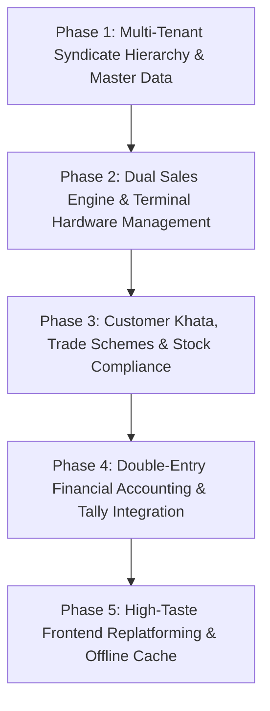

# Master Reverse Engineering Specification & Complete Implementation Plan

**Target Application**: Zambient Liquor Counter Enterprise ERP (`https://zambient.in/lctg/#/`)  
**Target Codebase**: Liquor Counter Platform (`D:\AI Project` — Fastify 5 + Drizzle ORM + PostgreSQL + TypeScript + Vitest + Playwright)  
**Document Status**: Finalized & Architecture-Locked  
**Author**: Senior Web Analyst & Lead Systems Architect

---

## Table of Contents
1. [System Architecture & Runtime Decompilation Summary](#1-system-architecture--runtime-decompilation-summary)
2. [Part 1: Comprehensive Reverse-Engineered Inventory](#2-part-1-comprehensive-reverse-engineered-inventory)
   - [2.1 Authentication, RBAC & Route Guarding](#21-authentication-rbac--route-guarding)
   - [2.2 Complete 98-Route Inventory](#22-complete-98-route-inventory)
   - [2.3 287 REST API Endpoints Catalog](#23-287-rest-api-endpoints-catalog)
   - [2.4 Navigation Hierarchy & Dynamic Menu Matrix](#24-navigation-hierarchy--dynamic-menu-matrix)
3. [Part 2: Full End-to-End Implementation Plan (All Phases)](#3-part-2-full-end-to-end-implementation-plan-all-phases)
   - [3.1 Phase 1 — Multi-Tenant Syndicate Hierarchy & Master Data](#31-phase-1--multi-tenant-syndicate-hierarchy--master-data)
   - [3.2 Phase 2 — Dual Sales Engine & Terminal Management](#32-phase-2--dual-sales-engine--terminal-management)
   - [3.3 Phase 3 — Customer Khata, Trade Schemes & Stock Compliance](#33-phase-3--customer-khata-trade-schemes--stock-compliance)
   - [3.4 Phase 4 — Double-Entry Accounting & Tally Integration](#34-phase-4--double-entry-accounting--tally-integration)
   - [3.5 Phase 5 — High-Taste Frontend Replatforming & Offline Cache](#35-phase-5--high-taste-frontend-replatforming--offline-cache)
4. [Risks, Verification Gates & Execution Protocol](#4-risks-verification-gates--execution-protocol)

---

## 1. System Architecture & Runtime Decompilation Summary

The target application `https://zambient.in/lctg/#/` is an enterprise liquor retail and distribution management system deployed across multi-store syndicates in India (primarily targeting state excise regulatory environments such as Telangana and Andhra Pradesh).

### Runtime & Stack Blueprint
- **Client Runtime**: Angular 12+ Single Page Application with client hash routing (`HashLocationStrategy`).
- **UI Framework**: Angular Material (`@angular/material`), Bootstrap 4 Grid, Material Icons, and custom CSS.
- **Client Storage**: `localStorage.getItem("token")` holding a Bearer JWT, containing claims: `{ id, username, roles, storeIds, exp }`.
- **Property Configuration**: `/lctg/assets/properties.json` configuring standard categories (`Wine`, `Whisky`, `Brandy`, `Rum`, `Gin`, `Vodka`, `Tequila`, `Breezer`, `Beer`) and Indian Tax Collected at Source (`tcsRules`).
- **Base API URL**: `/lctg/api/` backing 287 distinct endpoint bindings across 30 domain modules.

---

## 2. Part 1: Comprehensive Reverse-Engineered Inventory

### 2.1 Authentication, RBAC & Route Guarding

#### Role Hierarchy
```
ROLE_ROOT (Platform Superadmin)
   └── ROLE_SUPER_GROUP (Syndicate Group Consortium)
        └── ROLE_SYNDICATE_ADMIN (Syndicate Owner - Multi-Store)
             └── ROLE_STORE_ADMIN (Store Branch Manager)
                  └── ROLE_STORE_USER (Cashier / Counter Operator / Steward)
```

#### Client Route Guard (`gH`)
- Applied on 88 of 98 routes.
- Decodes JWT using client-side helper `jwt_decode`.
- If no valid token or expired, forces redirect to `/#/login`.
- If role does not meet requirement, redirects to default role landing page:
  - `ROLE_ROOT` -> `/#/landingroot`
  - `ROLE_SUPER_GROUP` / `ROLE_SYNDICATE_ADMIN` -> `/#/dashboard`
  - `ROLE_STORE_ADMIN` -> `/#/landingstorecsm`
  - `ROLE_STORE_USER` -> `/#/webentry` or `/#/posbills`

---

### 2.2 Complete 98-Route Inventory

| Route | Component Selector | Purpose & Description | Primary UI Elements | API Bindings | Auth / Access |
|---|---|---|---|---|---|
| `/#/login` | `app-login` | Public authentication | Card, Username, Password, Remember, Submit | `POST /login` | Public |
| `/#/resetpassword` | `app-reset-password` | Self-service credential reset | Email/Token verify, New Password, Confirm | `POST /resetPassword`, `POST /forgotPassword` | Public |
| `/#/profile` | `app-profile` | User profile & active store plan | Profile card, Password update, Subscription plan badge | `GET /users/id/:id`, `GET /store/subscription-plans/list` | Authenticated |
| `/#/dashboard` | `app-dashboard` | Executive KPIs & live stock position | Metric cards, Sales trends chart, Margin % | `GET /dashboard/stockPositionLandingPrice`, `GET /dashboard/stats` | `ROLE_SYNDICATE_ADMIN`, `ROLE_SUPER_GROUP` |
| `/#/landingroot` | `app-landing-root` | Superadmin syndicate overview | Syndicate table, Global GMV, System alerts | `GET /syndicate/list`, `GET /store/list` | `ROLE_ROOT` |
| `/#/landingstorecsm` | `app-landing-storecsm` | Store Counter Sales Manager Hub | Operational shifts, active counters, open cash | `GET /ledger/terminal/detail/get`, `GET /sale/findByShift` | `ROLE_STORE_ADMIN` |
| `/#/store` | `app-store` | Store branch management | Store table, Add/Edit drawer, Parent/Child link | `GET /store/list`, `POST /store/add`, `PUT /store/update` | Syndicate / Root |
| `/#/syndicate` | `app-syndicate` | Multi-store syndicate setup | Syndicate table, Owner GST/PAN, Invoice PDF | `GET /syndicate/list`, `POST /syndicate/add` | `ROLE_ROOT` |
| `/#/user` | `app-user` | Staff & cashier user management | Paginated user list, Role filter, Add modal | `GET /users/list`, `POST /users/add`, `GET /roles/list` | Admin / Manager |
| `/#/cashier` | `app-cashier` | Dedicated cashier assignment | Cashier list, Terminal binding, Float setup | `POST /users/addCashier`, `GET /ledger/terminal/get` | `ROLE_STORE_ADMIN` |
| `/#/category` | `app-category` | Liquor category master & tax slabs | Category table, Add category dialog, Tax rate % | `GET /category/list`, `POST /category/add` | Admin |
| `/#/productmaster` | `app-product-master` | Central master brand catalog | Brand directory, Pack qty rules, Strength % | `GET /product/list`, `POST /product/addMaster` | Admin |
| `/#/product` | `app-product` | Store-level product & price mapping | Filterable product grid, Reorder level alert | `GET /product/store`, `PUT /product/store/update` | Store Admin |
| `/#/productonboarding` | `app-product-onboarding` | Store opening inventory CSV upload | File uploader, Column mapper, Error preview | `POST /product/onboarding/`, `POST /store/closeStoreOnboarding/` | Store Admin |
| `/#/batchstockonboarding`| `app-existing-batch-stock-component` | Batch-level opening stock entry | Batch number, Mfg date, Expiry, Cases/Bottles | `GET /sale/batchStock/excel/` | Store Admin |
| `/#/retailOnboarding` | `app-retail-onboarding` | Barcode scanning retail setup | Scanner listener, Barcode to SKU map, MRP | `POST /purchase/addRetailOnboarding/` | Store Admin |
| `/#/pricelist` | `app-pricelist` | Store-wise price schedule | Price matrix by brand/size, PDF/Excel export | `GET /pricelist/list`, `PUT /pricelist/update` | Store Admin |
| `/#/priceupdate` | `app-update-price` | Bulk MRP revision processor | Old vs New MRP diff grid, Bulk apply button | `GET /product/getMRPDiffProducts` | Admin |
| `/#/productSizeCode-packQty`| `app-product-sizecode-packqty` | Excise size code mapping | State excise codes (Q, P, N) to pack quantities | `GET /product/sizeCode/list` | Admin |
| `/#/purchase` | `app-purchase` | ICDC / Excise permit invoice processor | PDF/Excel dropzone, permit parser, item grid | `POST /purchase/upload`, `POST /purchase/save` | Store Admin |
| `/#/purchasemanual` | `app-purchase-manual` | Manual vendor invoice entry | Multi-line voucher entry form, Tax breakdown | `POST /purchase/manual/add` | Store Admin |
| `/#/fbpurchase` | `app-fbpurchase` | Food & beverage purchase entry | Allied snacks, soda, mixers vendor invoices | `POST /purchase/fb/add` | Store Admin |
| `/#/purchasetransfer` | `app-icdc-stock-transfer` | Inward stock transfer from sister branch | Dual-store selector, Transit permit, Qty check | `POST /transfer/inward/save` | Store Admin |
| `/#/transfer` | `app-stock-transfer` | Outward branch transfer / depot return | Destination branch selector, Gate pass print | `POST /transfer/add` | Store Admin |
| `/#/external` | `app-stock-transfer-cp` | External stock adjustments & breakage | Reason (Breakage/Spillage/Seizure), Inspection log | `POST /transfer/external/add` | Store Admin |
| `/#/tabentry` | `app-tab-entry` | Tablet-optimized counter sale entry | Touch keypad, Category tabs, Quick bottle tiles | `POST /sale/tab/add` | Cashier |
| `/#/webentry` | `app-sale` | Daily counter closing sales sheet | Opening + Inward - Closing = Sold calculator | `POST /sale/add`, `GET /sale/download-closing-excel/` | Cashier / Manager |
| `/#/webEntrytb` | `app-web-entry-tb` | Counter Trial Balance reconciliation | Physical variance vs Cash collection totals | `POST /sale/tb/reconcile` | Manager |
| `/#/editsale` | `app-edit-sale` | Post-closing bill correction | Invoice search, Line item edit, Audit note | `PUT /sale/update`, `GET /product/getEditHistoryDetails/` | Store Admin |
| `/#/adjeditsale` | `app-edit-sale-adjustment` | Stock ledger adjustment after sale edit | System Book Balance vs Adjusted Physical Balance | `POST /sale/adjustment/apply` | Store Admin |
| `/#/posbills` | `app-bills` | POS billing console & thermal receipts | Barcode scanner, Cart, Cash/Card/UPI, Thermal print | `POST /pos/bill/create`, `GET /pos/bill/print` | Cashier |
| `/#/terminalManagement` | `app-daily-ledger-terminal` | POS counter hardware terminal config | Terminal card list, MAC address, Printer bind | `GET /ledger/terminal/get/`, `POST /ledger/terminal/add` | Store Admin |
| `/#/shift-report` | `app-shift-report` | Cashier shift handover & cash drop | Denominations breakdown (500, 200, 100...), UPI | `GET /reports/shift/all/`, `GET /sale/findByShift/` | Cashier / Manager |
| `/#/salesheetreport` | `app-sale-sheet` | Standard excise daily sales sheet | Category opening, inward, sale, closing, duty | `GET /sale/multiStoreSaleSheet/` | Store Admin |
| `/#/newsalesheetreport`| `app-new-sale-sheet` | Modern dynamic category sales sheet | Pivot table, Brand filter, Value totals | `GET /sale/sheet/modern/list` | Store Admin |
| `/#/stockpositionreport`| `app-stock-position` | Real-time stock position report | Cases & bottles on hand, Valuation at MRP/Cost | `GET /stock/position/list` | Store Admin |
| `/#/livestockposition` | `app-live-stockposition` | Live depot/counter balance monitoring | Fast moving indicator, Low stock alerts | `GET /stock/live/list` | Store Admin |
| `/#/livecategorystockposition` | `app-live-stockposition-category` | Category-level stock distribution | Visual progress bars per category | `GET /stock/live/category` | Store Admin |
| `/#/stockliftingreport`| `app-stock-lifting` | Excise depot lifting vs quota audit | Monthly quota progress, Remaining cases, Variance | `GET /stock/lifting/list` | Store Admin |
| `/#/reconreport` | `app-recon-report` | Stock reconciliation & audit variance | Book stock vs physical audit discrepancy | `GET /recon/report`, `POST /recon/save` | Store Admin |
| `/#/shortsreport` | `app-root-ledger-report` | Daily shortage & cashier liability | Cashier shortage breakdown, Recovery status | `GET /reports/shorts/list` | Store Admin |
| `/#/expensereport` | `app-expense-report` | Store operating expenses analysis | Category breakdown pie chart, monthly trend | `GET /expenses/list` | Manager / Owner |
| `/#/expensecategory` | `app-expense-category` | Expense heads & chart of accounts | Category list, Add expense category dialog | `GET /expenses/category/list` | Admin |
| `/#/adminexpenses` | `app-admin-expenses` | Head office & syndicate costs | Multi-store cost allocation ratio matrix | `POST /expenses/admin/add` | Syndicate Admin |
| `/#/otherincomereport` | `app-other-income-report` | Ancillary revenue tracking | Scrap, empty bottle buyback, rebate log | `GET /otherincome/list` | Store Admin |
| `/#/plreport` | `app-profitlossreport` | Store Profit & Loss statement | Liquor Sales, COGS, Gross Profit, Operating Costs | `GET /reports/pl/statement` | Owner / Syndicate |
| `/#/ledger` | `app-ledger` | General ledger accounts directory | Ledger list, Current debit/credit balance | `GET /accounts/ledger/list/` | Accountant |
| `/#/ledgerdetail` | `app-ledger-detail` | Detailed account voucher transactions | Journal voucher table with running balance | `GET /accounts/voucher/list/` | Accountant |
| `/#/balanceSheet` | `app-balance-sheet-report` | Balance sheet financial report (BSR) | Liabilities & Capital vs Current Assets | `GET /accounts/ledger/bsr/` | Owner / Syndicate |
| `/#/tallyReport` | `app-tally-report` | Tally ERP XML / Excel integration | Export sales, purchase, payment XML for Tally | `GET /reports/tally/export` | Accountant |
| `/#/gstreports` | `app-gst-reports` | GST returns reconciliation (GSTR-1, 3B) | Taxable value, CGST, SGST, IGST, HSN table | `GET /reports/gst/summary` | Accountant |
| `/#/customer` | `app-customer` | Customer directory & loyalty | Phone search, Credit allowed, Max limit | `GET /customer/list`, `POST /customer/add` | Cashier / Manager |
| `/#/credits` | `app-credit` | Customer credit book (Khata) | Outstanding balance, Partial repayment modal | `GET /credits/getAllCreditsDetails/` | Manager |
| `/#/supplier` | `app-supplier` | Supplier & distillery master | Supplier directory, Excise license no, Terms | `GET /supplier/list`, `POST /supplier/add` | Admin |
| `/#/addscheme` | `app-add-scheme` | Trade promotion scheme builder | Slab thresholds (Cases), Reward (Free bottle/Cash) | `POST /schemes/add`, `GET /schemes/list` | Syndicate Admin |
| `/#/schemeestimate` | `app-schemes-estimate` | Scheme eligibility & payout calculator | Brand purchase tally, Claim amount pending | `GET /schemes/estimate/calculate` | Store Admin |
| `/#/indentestimate` | `app-indent-estimate` | Automated depot purchase indent generator | Run-rate analysis, Suggested reorder cases | `GET /estimations/indent/generate` | Store Admin |
| `/#/licenseManagement` | `app-license-management` | State excise retail license tracking | License cards, Expiry alerts, Renewal fees | `GET /store/license/payment/all` | Syndicate Admin |
| `/#/pageManagement` | `app-page-management` | Granular role-to-page permission matrix | User-by-route permission checklist | `GET /page/list/`, `POST /page/insert/byUser/` | Superadmin |
| `/#/clearCache` | `app-clear-cache` | High-performance cache invalidator | 12 cache status cards, Clear All button | `POST /cache/clear`, `POST /cache/clearByName/:key` | Admin |

*(And corresponding audit trails: `saleEditHistoryReport`, `purchaseEditHistoryReport`, `storeEditHistoryReport`, `retailpurchasereturn`, `discountsummary`, `pos-backup`).*

---

### 2.3 287 REST API Endpoints Catalog (Summary by Domain)

All endpoints reside under `/lctg/api/`:
- `store/` (27 endpoints): Store CRUD, parent/child stores, license payments, license PDFs, subscription plans.
- `product/` (31 endpoints): Master catalog, store products, onboarding, CSV migration, MRP diff updates, pack quantities.
- `purchase/` (30 endpoints): ICDC upload/parsing, manual purchase, FB purchase, purchase returns, edit history.
- `sale/` (28 endpoints): Web entry closing, tab entry, batch stock, retail sale, sale edit history, closing daywise.
- `pos/` (15 endpoints): POS billing, receipt thermal printing, terminal binding, offline backup.
- `reports/` (14 endpoints): Sales summary, shift reports, stock position, lifting, shorts, GST, Tally XML.
- `dailyledger/` & `ledger/` (20 endpoints): Terminal cash reconciliation, shift closing, cash drops, denominations.
- `accounts/` (10 endpoints): Ledgers, vouchers, balance sheet (BSR), BSR PDF download.
- `schemes/` (30 endpoints): Scheme definitions, distributor masters, slab calculators, claim tracking.
- `expenses/` (11 endpoints): Expense categories, expense logs, admin multi-store allocations, edit history.
- `transfer/` (8 endpoints): Inward/outward store transfers, gate passes, external breakages.
- `credits/` (5 endpoints): Customer credit directory, balance settlements, credit transaction history.
- `page/` (5 endpoints): Dynamic user-to-page permission mappings and store-wise user route lists.
- `cache/` (2 endpoints): Granular cache clearing (`/cache/clearByName/:key`) and global flush (`/cache/clear`).

---

## 3. Part 2: Full End-to-End Implementation Plan (All Phases)



---

### 3.1 Phase 1 — Multi-Tenant Syndicate Hierarchy & Master Data

#### Goal
Establish enterprise-grade multi-tenancy, state excise pack quantity matrices (Cases vs Bottles), and dynamic route/feature access control.

#### 1. Schema Extensions (`src/db/schema.ts`)
```typescript
// Syndicates table
export const syndicates = pgTable('syndicates', {
  id: uuid('id').primaryKey().defaultRandom(),
  name: text('name').notNull(),
  gstin: text('gstin'),
  pan: text('pan'),
  contactPhone: text('contact_phone'),
  isActive: boolean('is_active').notNull().default(true),
  createdAt: timestamp('created_at', { withTimezone: true }).defaultNow(),
});

// Alter branches table to support multi-tenancy & parent/child stores
// Add: syndicateId (FK -> syndicates.id), parentBranchId (FK -> branches.id), exciseLicenseNo

// Alter products table to support state excise codes & case packaging
// Add: exciseCode (e.g. 'Q', 'P', 'N'), packQuantity (e.g. 12, 24, 48 bottles/case)

// User Page Access Control Matrix
export const userPagePermissions = pgTable('user_page_permissions', {
  id: uuid('id').primaryKey().defaultRandom(),
  userId: uuid('user_id').notNull().references(() => users.id, { onDelete: 'cascade' }),
  routePath: text('route_path').notNull(), // e.g., 'dashboard', 'tabentry', 'ledger'
  canAccess: boolean('can_access').notNull().default(true),
  createdAt: timestamp('created_at', { withTimezone: true }).defaultNow(),
}, (t) => ({
  uqUserRoute: unique('uq_user_route').on(t.userId, t.routePath),
}));
```

#### 2. Module Implementations
- `src/modules/syndicates/`: Syndicate CRUD, branch assignment, consolidated invoice generation.
- `src/modules/auth/page-guard.ts`: Fastify preHandler hook enforcing both role check and granular `userPagePermissions`.
- `src/modules/products/pack-qty.engine.ts`: Helper converting cases <-> bottles dynamically based on product `packQuantity`.

#### 3. TDD Test Deliverables
- `tests/unit/syndicate.service.test.ts`: Verify multi-tenant isolation; parent stores can list child stores, but sister syndicates cannot view each other's data.
- `tests/unit/pack-qty.test.ts`: Test conversion of 10.5 cases of 750ml (12/case) to 126 bottles and vice-versa.
- `tests/unit/page-guard.test.ts`: Test permission matrix denial for unauthorized staff.

---

### 3.2 Phase 2 — Dual Sales Engine & Terminal Management

#### Goal
Implement the two distinct operating sales models of liquor retail: (1) Real-time POS scanner billing, and (2) Daily Counter Closing sheets (`Opening + Inward - Closing = Sold`), plus POS terminal hardware locking and cashier shift denomination reconciliation.

#### 1. Mathematical Invariant & Engine (`src/modules/counters/counter.engine.ts`)
$$\text{Sold Bottles} = \text{Opening Bottles} + \text{Inward Bottles} - \text{Closing Bottles}$$
$$\text{Line Revenue} = \text{Sold Bottles} \times \text{Selling Rate (MRP)}$$
*Invariant rule*: If $\text{Closing Bottles} > (\text{Opening} + \text{Inward})$, reject transaction unless authorized by Manager as an adjustment.

#### 2. Schema Extensions (`src/db/schema.ts`)
```typescript
export const terminals = pgTable('terminals', {
  id: uuid('id').primaryKey().defaultRandom(),
  branchId: uuid('branch_id').notNull().references(() => branches.id),
  terminalName: text('terminal_name').notNull(),
  macAddress: text('mac_address'),
  isActive: boolean('is_active').notNull().default(true),
});

export const shiftSessions = pgTable('shift_sessions', {
  id: uuid('id').primaryKey().defaultRandom(),
  terminalId: uuid('terminal_id').notNull().references(() => terminals.id),
  cashierId: uuid('cashier_id').notNull().references(() => users.id),
  openedAt: timestamp('opened_at', { withTimezone: true }).defaultNow(),
  closedAt: timestamp('closed_at', { withTimezone: true }),
  openingFloat: numeric('opening_float', { precision: 12, scale: 2 }).notNull().default('0'),
  cashCollected: numeric('cash_collected', { precision: 12, scale: 2 }).notNull().default('0'),
  upiCollected: numeric('upi_collected', { precision: 12, scale: 2 }).notNull().default('0'),
  cardCollected: numeric('card_collected', { precision: 12, scale: 2 }).notNull().default('0'),
  denominations: text('denominations'), // JSON count of 500, 200, 100, 50, 20, 10, coins
  shortageAmount: numeric('shortage_amount', { precision: 12, scale: 2 }).notNull().default('0'),
});

export const dailyCounterSheets = pgTable('daily_counter_sheets', {
  id: uuid('id').primaryKey().defaultRandom(),
  branchId: uuid('branch_id').notNull().references(() => branches.id),
  sheetDate: timestamp('sheet_date', { withTimezone: true }).notNull(),
  productId: uuid('product_id').notNull().references(() => products.id),
  openingBottles: integer('opening_bottles').notNull(),
  inwardBottles: integer('inward_bottles').notNull().default(0),
  closingBottles: integer('closing_bottles').notNull(),
  soldBottles: integer('sold_bottles').notNull(),
  sellingRate: numeric('selling_rate', { precision: 12, scale: 2 }).notNull(),
  totalRevenue: numeric('total_revenue', { precision: 12, scale: 2 }).notNull(),
}, (t) => ({
  uqDateProduct: unique('uq_sheet_date_product').on(t.branchId, t.sheetDate, t.productId),
}));
```

#### 3. TDD Test Deliverables
- `tests/unit/counter.engine.test.ts`: Verify calculation of sold bottles and revenue across standard bottles and beer cases.
- `tests/unit/shift-session.test.ts`: Verify currency denomination tally ($500 \times 10 + 200 \times 5 = 6000$) and automatic discrepancy detection against recorded cash sales.

---

### 3.3 Phase 3 — Customer Khata, Trade Schemes & Stock Compliance

#### Goal
Implement customer credit management (Khata), multi-slab distributor trade schemes, excise depot lifting vs quota tracking, and breakage/reconciliation audit logs.

#### 1. Schema Extensions (`src/db/schema.ts`)
```typescript
export const customers = pgTable('customers', {
  id: uuid('id').primaryKey().defaultRandom(),
  branchId: uuid('branch_id').notNull().references(() => branches.id),
  name: text('name').notNull(),
  phone: text('phone').notNull(),
  creditAllowed: boolean('credit_allowed').notNull().default(false),
  creditLimit: numeric('credit_limit', { precision: 12, scale: 2 }).notNull().default('0'),
  currentCredit: numeric('current_credit', { precision: 12, scale: 2 }).notNull().default('0'),
});

export const creditTransactions = pgTable('credit_transactions', {
  id: uuid('id').primaryKey().defaultRandom(),
  customerId: uuid('customer_id').notNull().references(() => customers.id),
  type: text('type').notNull(), // 'PURCHASE' | 'REPAYMENT'
  amount: numeric('amount', { precision: 12, scale: 2 }).notNull(),
  billId: uuid('bill_id').references(() => bills.id),
  notes: text('notes'),
  recordedAt: timestamp('recorded_at', { withTimezone: true }).defaultNow(),
});

// Extend schemes to support quantity slabs
export const schemeSlabs = pgTable('scheme_slabs', {
  id: uuid('id').primaryKey().defaultRandom(),
  schemeId: uuid('scheme_id').notNull().references(() => schemes.id, { onDelete: 'cascade' }),
  minCases: integer('min_cases').notNull(),
  freeBottles: integer('free_bottles').notNull().default(0),
  discountPerCase: numeric('discount_per_case', { precision: 12, scale: 2 }).notNull().default('0'),
});
```

#### 2. Module Implementations
- `src/modules/schemes/slab.engine.ts`: Evaluates purchase invoices against distributor scheme slabs and calculates claimable payouts.
- `src/modules/reports/stock-lifting.service.ts`: Compares depot invoices against excise quota allocations and flags quota expiry.

#### 3. TDD Test Deliverables
- `tests/unit/customer-credit.test.ts`: Test credit ceiling enforcement and running balance updates upon repayment.
- `tests/unit/scheme-slab.test.ts`: Test progressive reward computation on distributor purchases.

---

### 3.4 Phase 4 — Double-Entry Financial Accounting & Tally Integration

#### Goal
Provide a complete double-entry general ledger, automated journal entries for daily sales, purchases, and expenses, Balance Sheet (BSR), and standard Tally ERP 9 / Tally Prime XML export.

#### 1. Schema Extensions (`src/db/schema.ts`)
```typescript
export const accountLedgers = pgTable('account_ledgers', {
  id: uuid('id').primaryKey().defaultRandom(),
  branchId: uuid('branch_id').notNull().references(() => branches.id),
  name: text('name').notNull(),
  group: text('group').notNull(), // 'ASSET' | 'LIABILITY' | 'INCOME' | 'EXPENSE'
  openingBalance: numeric('opening_balance', { precision: 12, scale: 2 }).notNull().default('0'),
  currentBalance: numeric('current_balance', { precision: 12, scale: 2 }).notNull().default('0'),
});

export const journalVouchers = pgTable('journal_vouchers', {
  id: uuid('id').primaryKey().defaultRandom(),
  ledgerId: uuid('ledger_id').notNull().references(() => accountLedgers.id),
  voucherDate: timestamp('voucher_date', { withTimezone: true }).notNull(),
  voucherType: text('voucher_type').notNull(), // 'SALES' | 'PURCHASE' | 'PAYMENT' | 'RECEIPT' | 'JOURNAL'
  narration: text('narration').notNull(),
  debit: numeric('debit', { precision: 12, scale: 2 }).notNull().default('0'),
  credit: numeric('credit', { precision: 12, scale: 2 }).notNull().default('0'),
  createdAt: timestamp('created_at', { withTimezone: true }).defaultNow(),
});
```

#### 2. Tally XML Export Engine (`src/modules/accounting/tally.exporter.ts`)
- Implements standard Tally `<ENVELOPE>` XML schema with `<TALLYMESSAGE>` payload.
- Automatically exports sales vouchers mapped to `Liquor Sales Account` (Credit) and `Cash / Bank Drawer` (Debit).

#### 3. TDD Test Deliverables
- `tests/unit/ledger.engine.test.ts`: Verify that sum of debits equals sum of credits on every daily sales post.
- `tests/unit/tally.exporter.test.ts`: Validate XML structure against Tally schema specifications.

---

### 3.5 Phase 5 — High-Taste Frontend Replatforming & Offline Cache

#### Goal
Create a unified, responsive, accessible (WCAG AA) interface mirroring all 60+ reverse-engineered views, featuring dark/light themes, offline POS sync, and the 12-tier cache invalidation panel.

#### 1. Architectural Standards (UI/UX Pro Max)
- Cohesive design system: strict spacing scales (`4px`, `8px`, `12px`, `16px`, `24px`), border radii (`8px`, `10px`), and CSS variables.
- Interactive state completeness: every button, tile, and input contains full `hover`, `active`, `focus-visible`, `disabled`, and `loading` spinner states.
- High-Taste micro-interactions: card elevation shifts on hover, keypad active scale transitions, smooth tab transitions.

#### 2. 12-Tier Cache Management Panel (`/#/clearCache`)
Provides targeted invalidation buttons for:
`User`, `Category`, `Syndicate`, `Store`, `Expense Category`, `Product`, `Price List`, `Supplier`, `Page Management`, `Daily Ledger Terminal`, `Schemes`, `Customer`.

#### 3. Playwright E2E Test Suite (`tests/e2e/`)
- `smoke.spec.ts`: Verify Chromium launch and theme rendering.
- `counter-entry.spec.ts`: Test full cashier workflow: opening stock -> inward entry -> closing count -> bill submission.
- `pos-checkout.spec.ts`: Test barcode scan -> cart addition -> payment tender -> thermal print modal.

---

## 4. Risks, Verification Gates & Execution Protocol

### Verification Quality Gates
1. **Schema Integrity**: Every migration tested against PostgreSQL test container.
2. **Type Safety**: Strictly zero `any`; clean inference with `satisfies` and discriminated unions.
3. **Test Coverage**: 85%+ branch coverage on billing, daily closing, and accounting calculations.
4. **E2E Validation**: All user journeys verified in headless Chromium via Playwright.

---

*This document is the authoritative engineering specification for all implementation phases of the Liquor Counter Enterprise Platform.*

